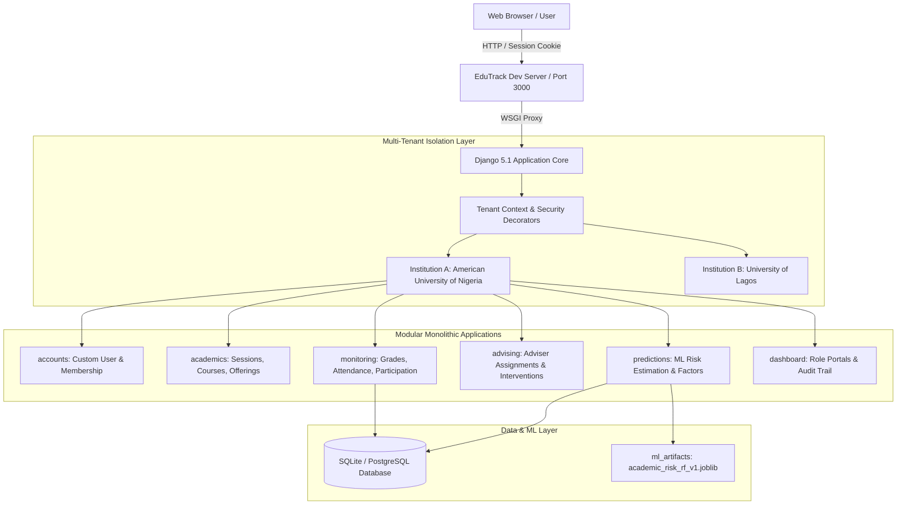
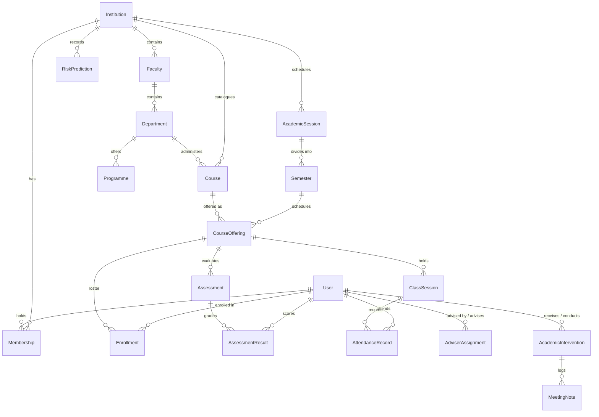

# EduTrack: Academic Management Platform

**Project Category:** Educational Technology (Object-Oriented Software Construction)  
**Author / Developer:** Software Engineering Student  
**Architecture:** Modular Monolithic Django Platform with Logical Multi-Tenancy  

---

## 1. Project Overview & Problem Solved
Higher education institutions often struggle to identify students experiencing academic difficulty before it is too late. Traditional semester examination records are static and retrospective: by the time final semester marks are calculated, course failure has already occurred.

**EduTrack** solves this problem by providing a centralized, multi-tenant monitoring platform that tracks attendance and continuous assessments (quizzes, assignments, midterms). It uses a calibrated machine-learning model (Random Forest Classifier) to identify early indicators of difficulty, generating advisory alerts for students and academic advisers so timely interventions can take place.

---

## 2. Object-Oriented Software Construction (OOSC) Principles

### A. Encapsulation
- Domain data and associated business calculations are encapsulated directly inside model methods rather than scattered across views:
  - `Enrollment.compute_current_score()`: Calculates weighted assessment progress.
  - `Enrollment.get_attendance_percentage()`: Computes attendance percentage from lecture records.
  - `AssessmentResult.clean()`: Enforces score bounds (0 ≤ score ≤ max_score) at the model layer.
  - `AcademicIntervention.mark_resolved()`: Manages state transitions and documentation.

### B. Abstraction
- The `TenantAwareModel` abstract base class abstracts institutional ownership and timestamps away from concrete models (`Course`, `Assessment`, `Enrollment`, `AttendanceRecord`, `RiskPrediction`).
- The `RiskPredictionService` provides a clean singleton service layer that hides feature extraction, matrix shaping, and scikit-learn model inference behind a single method call: `evaluate_and_predict(student, semester, institution)`.

### C. Inheritance
- `accounts.User` inherits from Django's `AbstractUser`, extending it with institutional identification numbers (matriculation number, staff ID), email-based authentication, and multi-tenant helper methods.
- Domain entities inherit from `TenantAwareModel`, enforcing multi-institution isolation across the database.

### D. Polymorphism
- Unified role-based dispatching in `dashboard:home` polymorphically resolves user contexts to role-tailored dashboards (`STUDENT`, `INSTRUCTOR`, `ADVISER`, `REGISTRAR`, `INSTITUTION_ADMIN`, `PLATFORM_ADMIN`).

### E. Modularity & Separation of Concerns
- The codebase is strictly partitioned into single-responsibility applications:
  - `accounts/`: Authentication, user identity, institutional membership bridge.
  - `institutions/`: University tenants, faculties, departments, and degree programmes.
  - `academics/`: Sessions, semesters, course catalogue, offerings, and student enrollment.
  - `monitoring/`: Assessments, continuous marks, attendance sheets, and participation.
  - `advising/`: Student-adviser assignments, intervention workflows, and meeting logs.
  - `predictions/`: Machine-learning pipeline, advisory risk classifications, and explainability.
  - `dashboard/`: Role portals, visual analytics, and immutable security audit logs.

---

## 3. System Architecture & Multi-Tenancy Diagram



---

## 4. Entity Relationship Diagram (ERD)



---

## 5. Machine Learning Methodology & Evaluation

### Objective
To identify students at risk of academic difficulty early in the semester using attendance patterns, quiz marks, continuous assessments, and historical standing.

### Data Disclaimer (Important)
The deployed model was trained on a **synthetic dataset** generated at training time by `data/train_risk_model.py` — not on real student records. The metrics below were recorded from a **single train/test evaluation run** on that synthetic data. They have **not** been cross-validated and have **never been validated against real institutional data**, so they do not represent expected real-world performance. These facts are recorded in the `provenance` block of `ml_artifacts/model_metrics_v1.json` and surfaced as a warning on the model documentation page.

### Algorithm Comparison
Three supervised classifiers were evaluated on a held-out test split of the synthetic dataset:

| Model Candidate | Accuracy | Precision | Overall Recall | F1-Score | High-Risk Recall |
|---|---|---|---|---|---|
| **Logistic Regression (Baseline)** | 0.9707 | 0.9718 | 0.9707 | 0.9706 | 0.9915 |
| **Decision Tree (Max Depth 5)** | 0.8027 | 0.8096 | 0.8027 | 0.8040 | 0.7797 |
| **Random Forest Classifier (Deployed)** | 0.8587 | 0.8592 | 0.8587 | 0.8589 | 0.8644 |

### Deployment Note
Random Forest was fixed as the deployed artifact at first build and has been retained. In the recorded evaluation **Logistic Regression outperformed it on every metric**, including high-risk recall (0.9915 vs 0.8644) — the measure that matters most for an early-warning system. Explainability is not a differentiator: all candidates expose class probabilities and feature-based contributing factors. Before production use, the model should be retrained on real institutional data with cross-validated model selection.

### Probabilities
Predictions are expressed as percentages (0.0%–100.0%) from the model's class-probability output. These are advisory estimates, not calibrated confidence scores.

### Ethical Safeguards & Advisory Constraints
- **Strictly Advisory:** Predictions are decision-support artifacts for academic advisers. They **cannot** automatically fail, disqualify, or discipline students.
- **No Data Leakage:** Final semester exam marks are strictly excluded from the predictive features. Only continuous mid-term indicators are used.
- **Honest Retraining:** `data/train_risk_model.py` documents its synthetic-data synthesis, performs cross-validated model selection when retrained, and supports `--dry-run`. Retraining regenerates synthetic data and artifacts; training on real data requires an approved institutional data export.

---

## 6. Pre-Configured Test Personas (1-Click Evaluation)

All accounts share the development password: `Password123!`

| Persona Name | Role | Institution | Key Academic Scenario |
|---|---|---|---|
| **Emmanuel Okafor** | Student | AUN | **High Risk (99.0%)**: 33% attendance, 38% Midterm, active intervention |
| **Zainab Bello** | Student | AUN | **Good Standing (Low Risk 2.7%)**: 100% attendance, 92% Midterm |
| **Kalu Uche** | Student | AUN | **Moderate Risk (25.0%)**: 67% attendance, 62% Midterm |
| **Dr. Ibrahim Suleiman** | Instructor | AUN | Lecturer for CSC301 (OOSC) & SWE305. Manages grades & attendance |
| **Dr. Chioma Nnamdi** | Academic Adviser | AUN | Monitors advisees, early warning flags, and logs interventions |
| **Babatunde Ojo** | Registrar | AUN | Manages courses, offerings, and student enrollment rosters |
| **Fatima Danjuma** | Institution Admin | AUN | Reviews membership requests, user roles, and institutional audit logs |
| **Prof. Adeyemi Lawal** | Institution Admin | UNILAG | **Tenant Isolation Test**: Verifies UNILAG cannot view AUN records |
| **Dr. Aliyu Mohammed** | Platform Admin | Platform | Global platform administration across all university tenants |

---

## 7. How to Run Locally

```bash
# 1. Clone repository
git clone <repo-url>
cd edutrack

# 2. Activate virtual environment
python3 -m venv venv
source venv/bin/activate

# 3. Install requirements
pip install -r requirements.txt

# 4. Run database migrations
python manage.py migrate

# 5. Seed demonstration institutions and ML predictions
python manage.py seed_demo_data

# 6. Run test suite
python manage.py test tests

# 7. Start development server
python manage.py runserver
```

---

## 8. Test Execution Results

The automated suite lives in the `tests/` package and runs with `python manage.py test tests`:

| File | Focus |
|---|---|
| `tests/test_edutrack.py` | Object-oriented encapsulation methods (`compute_current_score`, `get_attendance_percentage`), out-of-range score guards, attendance aggregation, multi-tenant data isolation, ML inference service. |
| `tests/test_access_control.py` | Role-based access control for every portal, tenant-scoped query sets, POST-only state changes, CSRF enforcement. |
| `tests/test_remediation.py` | Registration password policy, deactivated-institution lockout, ML integrity (final-exam exclusion, minimum evidence), weight-aware analytics, duplicate-record constraints. |
| `tests/test_phase6_security.py` | Sign-in brute-force lockout with IP-audited failures, password change/reset flows with audit trails, membership suspend/reactivate/role-change with a last-administrator guard, platform first-administrator appointment, registrar workflows scoped to the active tenant, database integrity constraints, the `/health/` probe, and per-dashboard query budgets. |

Result: **105/105 tests passed (0 failures, 0 errors)** as measured on the Phase 6 remediation build (Django 5.2.19).

---

## 9. Backup & Recovery

### Development (SQLite, this repository)
- The database is a single file: `db.sqlite3` in the project root.
- Before schema-changing migrations or bulk data scripts, snapshot it:

  ```bash
  copy db.sqlite3 backups\<descriptive-name>.sqlite3
  ```

- The Phase 6 remediation started from the verified snapshot
  `backups/pre_phase6_20261115_213015.sqlite3`.
- **Restore procedure:** stop the development server, replace `db.sqlite3`
  with the snapshot copy, restart the server. Nothing else is required —
  never delete the live database to "reset" it.

### Production (PostgreSQL)
- Set `DJANGO_DB_ENGINE=postgres` plus the `DJANGO_DB_NAME`, `DJANGO_DB_USER`,
  `DJANGO_DB_PASSWORD`, `DJANGO_DB_HOST` and `DJANGO_DB_PORT` variables; the
  platform then runs on PostgreSQL with the psycopg 3 driver pinned in
  `requirements.txt`.
- Schedule nightly logical backups (`pg_dump --format=custom`), retain them
  off-site, and **verify a restore regularly** by loading a dump into a
  scratch database and running `manage.py check` and the test suite against it.
- Application secrets (`DJANGO_SECRET_KEY`, database credentials) are not
  stored in the database and must be recovered from the deployment's own
  secret store, not from backups.
